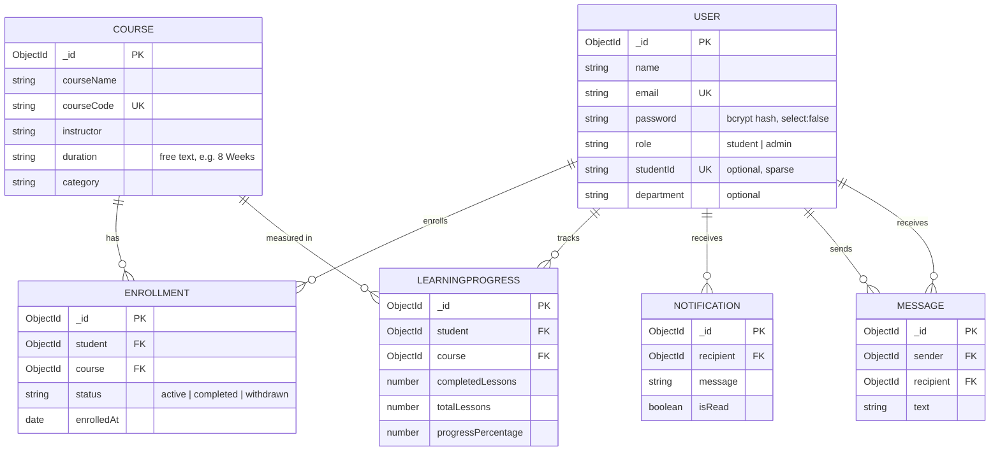

# Database Schema (MongoDB / Mongoose)

Database: `edubloom_course_system` (set with `MONGO_URI`). MongoDB generates the `_id` of every document.

## Relationship diagram

Notifications and chat messages reference users; enrollments and learning progress reference both users and courses.



Plain-text version:

```
                 +-----------+
                 |   USER    |
                 +-----------+
     1 /    1 |       | 1       \ 1
      /       |       |          \
   many     many    many         many
+------------+ +--------------+ +--------------+ +---------+
| ENROLLMENT | | LEARNING     | | NOTIFICATION | | MESSAGE |
| (student,  | | PROGRESS     | | (recipient)  | | (sender,|
|  course)   | | (student,    | +--------------+ |recipient)|
+------------+ |  course)     |                  +---------+
      many     +--------------+
        \          many
         \        /
          1      1
        +-----------+
        |  COURSE   |
        +-----------+
```

## Collections

All collections use `timestamps: true` (`createdAt`, `updatedAt`).

### users (`models/User.js`)

| Field | Type | Constraints |
| --- | --- | --- |
| name | String | required, trimmed, max 100 |
| email | String | required, **unique**, lowercase, trimmed |
| password | String | required, `select: false` (bcrypt hash, cost 12) |
| role | String | enum `student` / `admin`, default `student` |
| studentId | String | optional, **unique (sparse)**, max 50 |
| department | String | optional, max 100 |

### courses (`models/Course.js`)

Field names match the existing EduBloom course records so the current pages keep working.

| Field | Type | Constraints |
| --- | --- | --- |
| courseName | String | required, max 150 |
| courseCode | String | required, **unique**, max 30 |
| instructor | String | required, max 100 |
| duration | String | required, free text such as `8 Weeks` |
| category | String | required, max 80 |
| level, image, status, overview, language, certificate, enrollmentType, startDate, endDate, maxStudents | String | optional, with defaults |
| learningOutcomes, modules, prerequisites, videos, materials | [String] | optional, default `[]` |
| completed | Boolean | default `false` |

### enrollments (`models/Enrollment.js`)

| Field | Type | Constraints |
| --- | --- | --- |
| student | ObjectId -> User | required |
| course | ObjectId -> Course | required |
| status | String | enum `active` / `completed` / `withdrawn`, default `active` |
| enrolledAt | Date | default now |

Unique index: `{ student: 1, course: 1 }`. Unenrolling sets `status: "withdrawn"` (history is kept); enrolling again **reactivates** the same document, so the unique index is never violated.

### learningprogresses (`models/LearningProgress.js`)

| Field | Type | Constraints |
| --- | --- | --- |
| student | ObjectId -> User | required |
| course | ObjectId -> Course | required |
| completedLessons | Number | min 0 |
| totalLessons | Number | required, min 1 |
| progressPercentage | Number | 0 to 100 |

Unique index: `{ student: 1, course: 1 }`.

### notifications (`models/Notification.js`)

| Field | Type | Constraints |
| --- | --- | --- |
| recipient | ObjectId -> User | required |
| message | String | required, max 500 |
| isRead | Boolean | default `false` |

Index: `{ recipient: 1, createdAt: -1 }`.

### messages (`models/Message.js`)

| Field | Type | Constraints |
| --- | --- | --- |
| sender | ObjectId -> User | required |
| recipient | ObjectId -> User | required |
| text | String | required, max 2000 |

Index: `{ sender: 1, recipient: 1, createdAt: -1 }`.

## Deleting data

* Deleting a **student** (admin API) also deletes their enrollments, progress, notifications and messages.
* Deleting a **course** also deletes its enrollments and progress records.

These cleanups run as separate operations (no transaction), so on a standalone MongoDB server a crash between steps could leave partial cleanup. Use an Atlas cluster / replica set with transactions if you need all-or-nothing behaviour.
